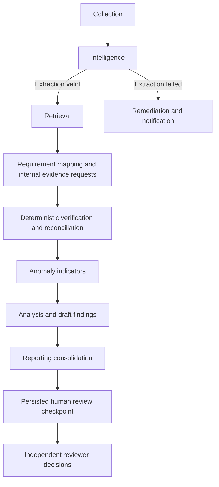

# Multi-agent workflow

LangGraph `StateGraph` invokes eight specialized backend functions in order:

Typed shared state contains audit ID, run ID, output, failure and review checkpoint flags. Every node returns a Pydantic `AgentOutput` with status, summary and structured data. Each node gets two attempts inside nested database transactions; exceptions stop further analysis and route to remediation. Logs retain input/output, elapsed time, errors and rule/prompt/model version.

Missing supporting categories create internal evidence requests. Presence never automatically produces reviewed completeness. Discrepancies become evidence-linked findings. Reviewed findings are preserved across repeated runs; new evidence never silently resolves them. Workflow completion moves the project to Under Review and notifies the assigned reviewer. Final approval is a separate authorized database operation, not a model decision or automatically resumed graph action.

The 60-second agent completion budget is checked after a node returns. It is not preemptive cancellation. OCR and optional HTTP model calls have separate subprocess/network timeouts. Long-running production work requires a durable task runner and cancellation boundary.
